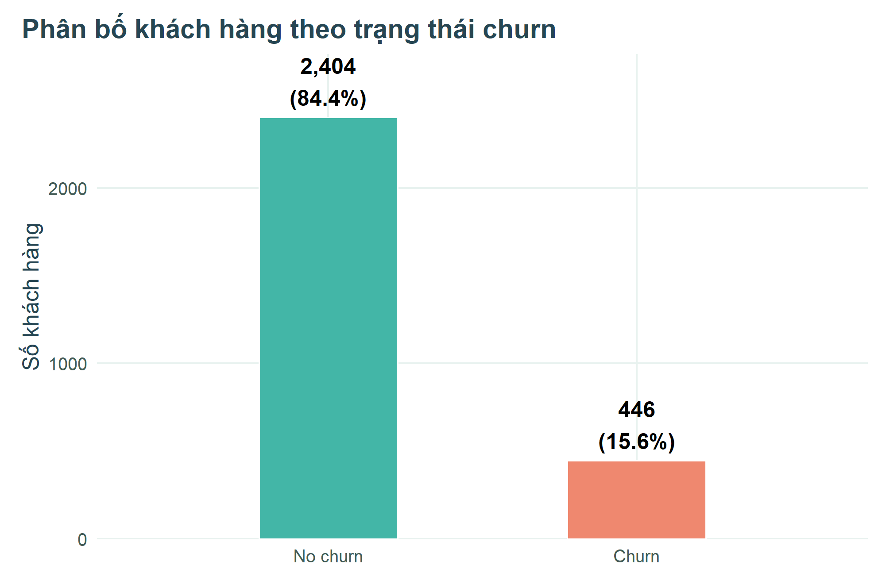
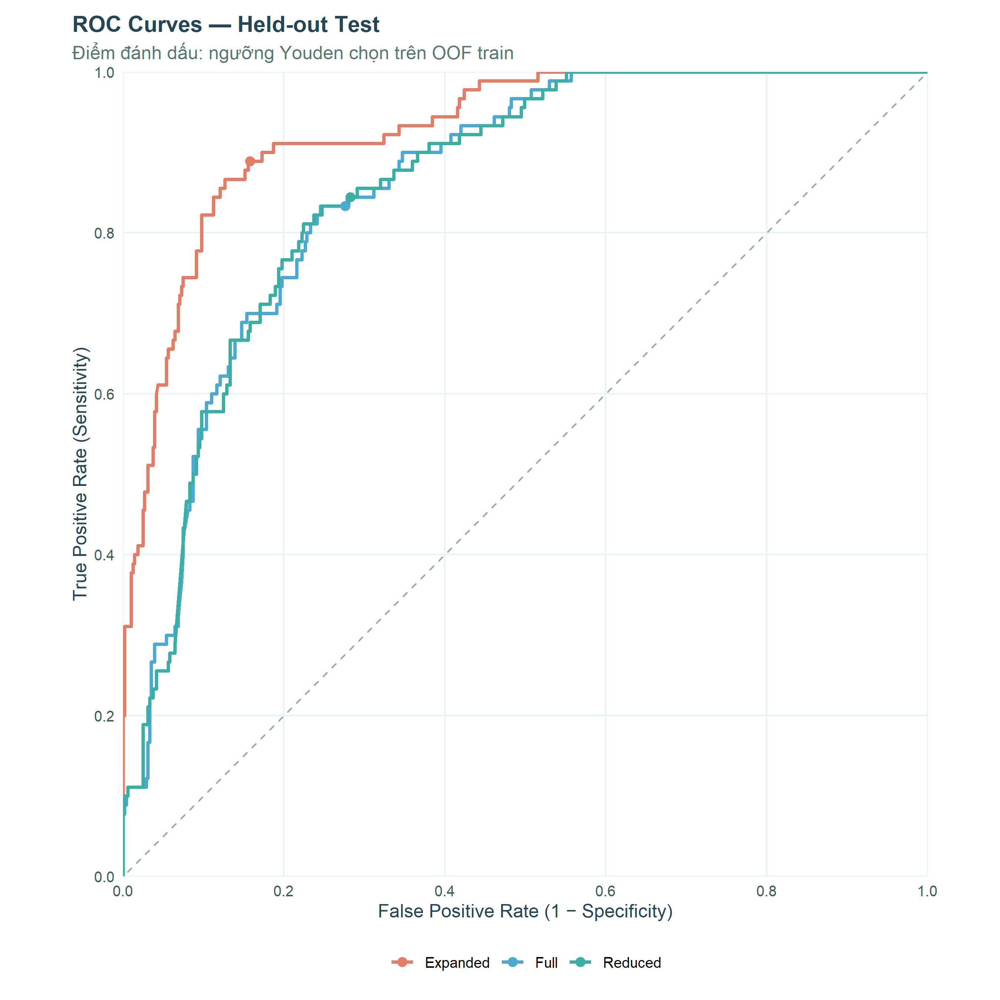
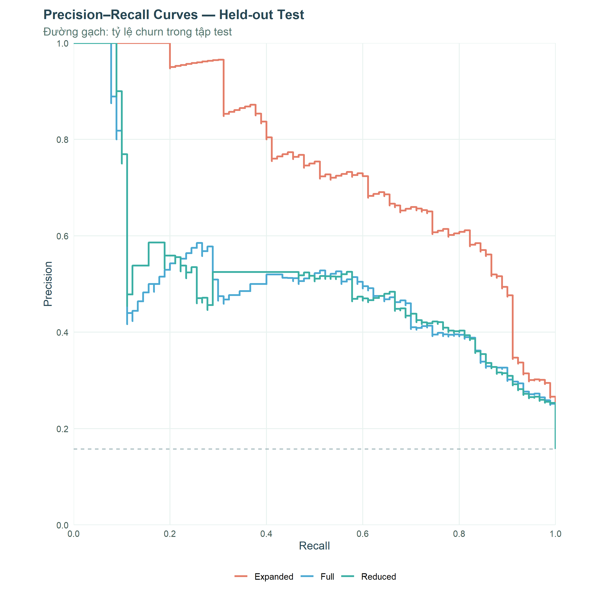

# Customer Churn Analysis & Prediction with R

**Statistical inference · Logistic regression · Cross-validation · Model evaluation**

An end-to-end statistical analysis of telecom customer churn using **R** and **R Markdown**. The project combines exploratory data analysis, bootstrap confidence intervals, permutation tests, and logistic regression to investigate churn patterns and prioritize customers for retention outreach.

> **Report language:** Vietnamese. This English README summarizes the objectives, workflow, results, and limitations.

**[View the report source (R Markdown)](Customer_Churn.Rmd)** · **[Rendered HTML report](docs/index.html)** · **[Dataset](data/Customer%20Churn.csv)**  
*For a browser-rendered HTML report, enable GitHub Pages from `main` → `/docs` as described below.*

## Key findings

| Measure | Result | Interpretation |
|:--|--:|:--|
| Original dataset | 3,150 rows, 14 columns | 13 predictors plus the churn target |
| After removing exact duplicate rows | 2,850 records | 300 identical rows removed; no customer ID is available to validate duplicates |
| Observed churn | 446 of 2,850 (15.65%) | Churn is a minority class |
| Expanded Logistic — held-out test ROC-AUC | **0.927** | Exploratory result; `status` timing is not verified |
| Expanded Logistic — held-out test average precision | **0.752** | Same caveat about possible timing / leakage risk |
| Reduced Logistic — held-out test ROC-AUC | **0.856** | Uses usage-related predictors only |
| Reduced Logistic — held-out test average precision | **0.514** | Separate from Expanded's headline score |
| Reduced Logistic — top 20% customers | **54/90 churners captured** | 60.0% recall at 20% outreach; lift **2.98×** vs random |

Scores come from the included generated report. **Do not interpret the Expanded model's higher test metrics as deployment readiness**: the timing of the `status` variable cannot be verified, and the Expanded specification was informed by exploratory analysis of the full sample.

## Visual overview



<details>
<summary>ROC and precision–recall curves (held-out test)</summary>





</details>

## Methods and workflow

1. **Data quality and EDA:** Explore 13 predictors and the binary churn label; inspect missing values, duplicates, unusual observations, churn rates, and variable relationships.
2. **Statistical inference:** Compare groups with **5,000 bootstrap resamples** and **10,000 permutation iterations**; use Holm adjustment for multiple permutation tests and Fisher's exact test as an additional check for tariff plans.
3. **Prediction:** Create an **80/20 stratified train/test split**; compare Full, Reduced (AIC-selected), and Expanded logistic regression models.
4. **Model selection:** Apply **5-fold out-of-fold cross-validation** on the training split and prioritize average precision for the imbalanced target. Derive decision thresholds from OOF training predictions.
5. **Held-out evaluation:** Report ROC-AUC, average precision, F1, sensitivity, specificity, balanced accuracy, Brier score, calibration, and confusion matrices on test data.
6. **Business interpretation:** Examine recall, precision, and lift when contacting the top 10%, 20%, and 30% of customers ranked by churn probability.

The analysis uses `set.seed(2026)` for reproducibility. Mathematical/statistical explanations and methodological cautions are documented in the R Markdown report.

## Repository layout

```text
customer-churn-statistical-analysis/
├── README.md                   # English project overview
├── Customer_Churn.Rmd          # Analysis source (Vietnamese)
├── data/
│   └── Customer Churn.csv      # Source dataset (CC BY 4.0)
├── docs/
│   └── index.html              # Self-contained rendered report, ready for GitHub Pages
├── assets/
│   ├── churn-distribution.png
│   ├── roc-curve.png
│   └── precision-recall-curve.png
├── requirements.R              # Package setup helper
├── DATA_LICENSE.md             # Data attribution and licensing
└── .gitignore
```

## Reproduce the report

Install [R](https://www.r-project.org/) and [RStudio](https://posit.co/download/rstudio-desktop/) (optional), then open this repository as your working directory.

```r
source("requirements.R")
rmarkdown::render("Customer_Churn.Rmd", output_file = "index.html", output_dir = "docs")
```

The input file must remain at `data/Customer Churn.csv`, as referenced in the R Markdown source. The `docs/index.html` included in this repository is the existing rendered report; it can be viewed even without running R.

## Publish the interactive report with GitHub Pages

On your GitHub repository, open **Settings → Pages → Build and deployment**, select **Deploy from a branch**, then choose **`main`** and **`/docs`**. After Pages is enabled, the report will be available at:

`https://phatban.github.io/customer-churn-statistical-analysis/`

This URL becomes usable **only after** the repository is created and Pages deployment succeeds. If you change the repository name or owner, update the address accordingly.

## Limitations and responsible interpretation

- The dataset lacks a unique customer identifier and observation timestamps. Exactly matching rows were removed as duplicates, but cannot be validated as duplicate customers.
- The collection/update timing of `status` is unclear; the Expanded model should not be considered deployment-ready.
- Expanded predictors were considered after whole-sample exploration; its reported test scores are best understood as exploratory.
- Joint model/threshold selection on out-of-fold training predictions may create optimistic CV estimates. Feature-selection uncertainty is not fully accounted for.
- Predicting churn does not demonstrate that contacting customers will causally reduce churn; that requires a controlled intervention.

## Data source and attribution

**Iranian Churn**, UCI Machine Learning Repository (2020).  
DOI: [10.24432/C5JW3Z](https://doi.org/10.24432/C5JW3Z) · [UCI dataset page](https://archive.ics.uci.edu/dataset/563/iranian+churn+dataset)

The source dataset is distributed under **Creative Commons Attribution 4.0 International (CC BY 4.0)**. See [DATA_LICENSE.md](DATA_LICENSE.md) for attribution. This statement concerns the **dataset**, not a blanket license for the analysis code.

## Author

**Tan Phat Nguyen** · [GitHub @Phatban](https://github.com/Phatban)
